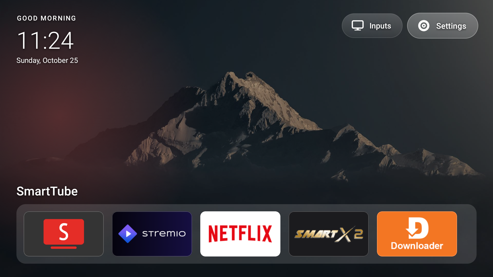
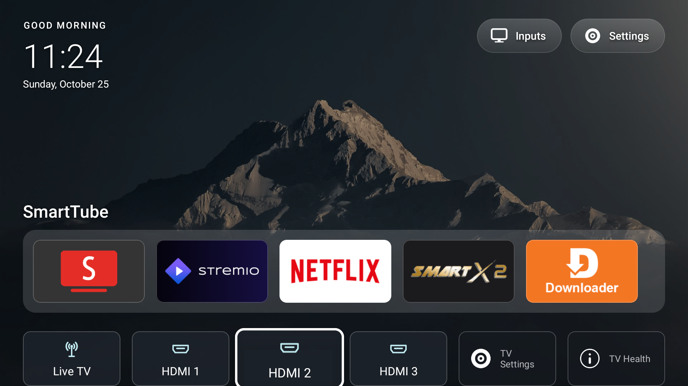
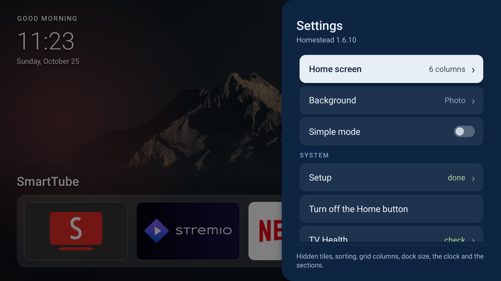

# Homestead redesign: screenshots

Taken from a Fire TV Edition TV (AFTBR92D74, Fire OS 8.1.8.5) running the branch [`home-redesign-tv-settings`](https://github.com/fablabvidalactea/Homestead/tree/home-redesign-tv-settings), proposed in [Sarg338/Homestead#27](https://github.com/Sarg338/Homestead/pull/27).

### First screen: clock, greeting and date, Inputs/Settings pills, dock

### Grid below the dock, with the focus effect and the TV Settings tile

### Homestead's Settings panel (from the Settings pill)

